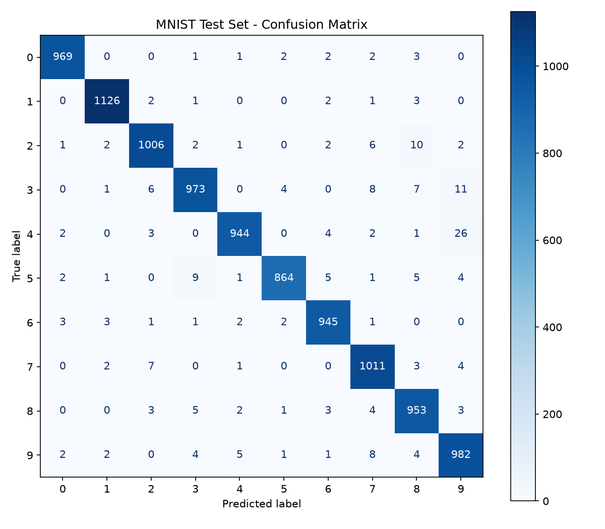
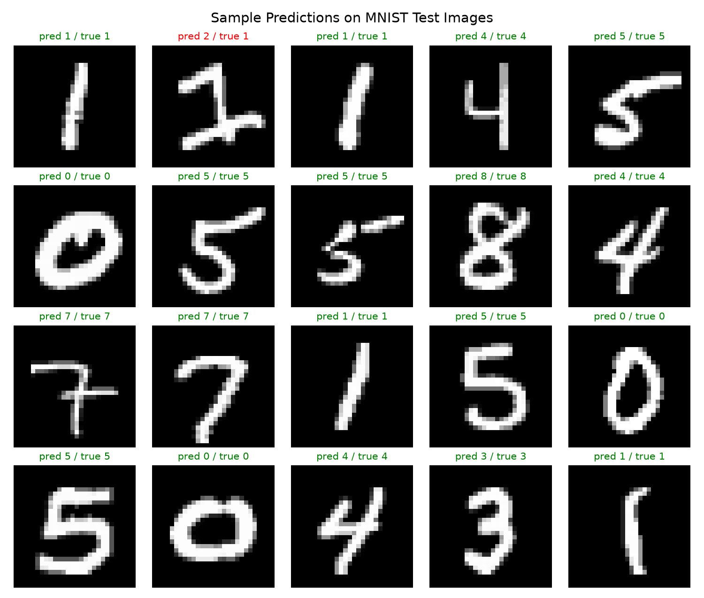

# Handwritten Digit Recognition (MNIST)

**Author:** Saket
**GitHub:** https://github.com/luffy-code244/digit-recognition

A clean, script-based machine learning project that recognises handwritten digits (0–9) using a
Multi-Layer Perceptron (MLP) neural network trained on the MNIST dataset with scikit-learn.
The trained model reaches **97.73 % accuracy on the 10,000-image MNIST test set**.

The trained model and all result plots are committed to the repository, so you can run predictions
immediately without retraining.

---

## Results

| Metric | Value |
|---|---|
| Test accuracy (10,000 images) | **97.73 %** |
| Train accuracy (60,000 images) | 99.40 % |
| Macro F1-score | 0.9772 |
| Misclassified test images | 227 / 10,000 |
| Epochs (early stopping) | 14 |
| Training time (8-core CPU) | ~20 s |

Most common confusions: 4 → 9 (26), 3 → 9 (11), 2 → 8 (10), 5 → 3 (9).

| Confusion matrix | Sample predictions |
|---|---|
|  |  |

Additional figures: [`outputs/training_curve.png`](outputs/training_curve.png),
[`outputs/misclassified.png`](outputs/misclassified.png). Full metrics: [`outputs/metrics.json`](outputs/metrics.json).

---

## Project structure

```
digit-recognition/
├── src/
│   ├── __init__.py
│   ├── common.py        # dataset loading + paths
│   ├── train.py         # train, evaluate, save model + plots
│   └── predict.py       # predict from image files or run an MNIST demo
├── models/
│   └── digit_model.joblib        # trained MLP model (committed)
├── outputs/
│   ├── confusion_matrix.png
│   ├── sample_predictions.png
│   ├── misclassified.png
│   ├── training_curve.png
│   ├── metrics.json
│   └── train_log.txt
├── samples/             # example digit images to try predict.py on
├── docs/assignment.md   # assignment report source
├── Assignment_Handwritten_Digit_Recognition.pdf
├── requirements.txt
└── README.md
```

---

## Setup

Requires Python 3.9+.

```bash
git clone https://github.com/luffy-code244/digit-recognition.git
cd digit-recognition
python -m venv .venv
source .venv/bin/activate        # Windows: .venv\Scripts\activate
pip install -r requirements.txt
```

## How to run

All commands are run from the project root.

**1. Predict with the included pre-trained model**

```bash
# Predict one or more image files (PNG/JPG, any size, light or dark background)
python -m src.predict --image samples/digit_7.png samples/handdrawn_7.png

# Demo on 10 random MNIST test images
python -m src.predict --demo -n 10
```

Example output:

```
samples/handdrawn_7.png: predicted digit = 7 (confidence 100.00%)
  top-3: 7 (100.0%), 3 (0.0%), 9 (0.0%)
```

**2. Retrain the model (optional)**

```bash
python -m src.train            # full training: 60k train / 10k test (~20 s training on a modern CPU; first run also downloads MNIST)
python -m src.train --quick    # quick smoke test on 10k training images
```

Training downloads MNIST from OpenML on first run (cached in `.cache/`), then writes
`models/digit_model.joblib`, all plots in `outputs/`, and `outputs/metrics.json`.

---

## Method (short)

- **Data:** MNIST, 70,000 grayscale 28×28 images; standard split of 60,000 train / 10,000 test.
- **Preprocessing:** each image is flattened to 784 features and pixel values are scaled from 0–255 to 0–1.
- **Model:** `MLPClassifier` with two hidden layers (256 and 128 ReLU units), Adam optimiser,
  learning rate 1e-3, batch size 128, L2 penalty 1e-4, early stopping on a 10 % validation split.
- **Evaluation:** accuracy, per-class precision/recall/F1, confusion matrix on the held-out test set.
- **Custom images:** `predict.py` converts images to grayscale, inverts light backgrounds, crops to the digit,
  resizes into a 20×20 box and centres it on a 28×28 canvas by centre of mass, the same way MNIST was prepared.

## Possible improvements

- A convolutional neural network (CNN) would reach ~99 %+ accuracy.
- Data augmentation (small rotations, shifts) for better handling of real handwriting.
- A small web or GUI drawing pad for live predictions.

## License

MIT
