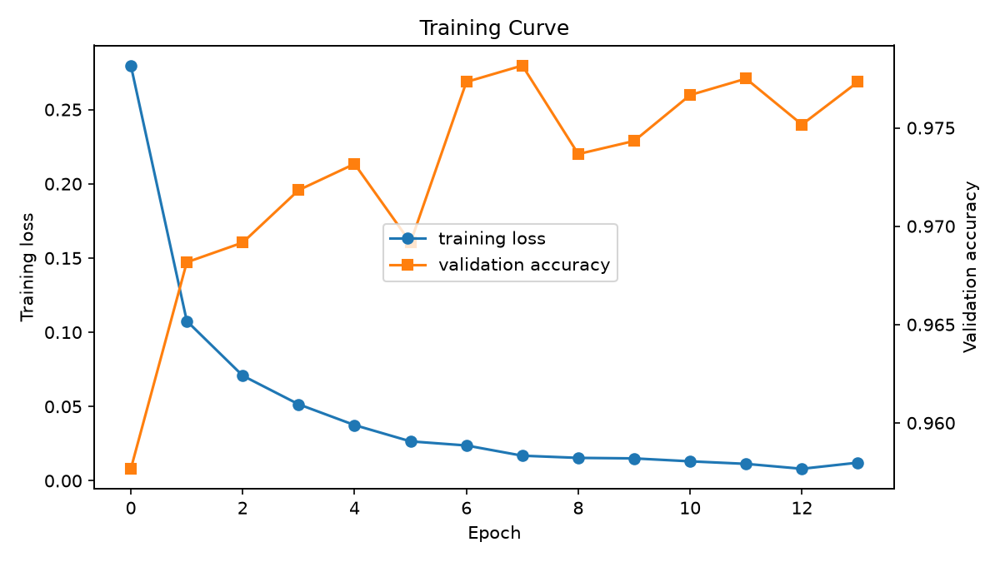
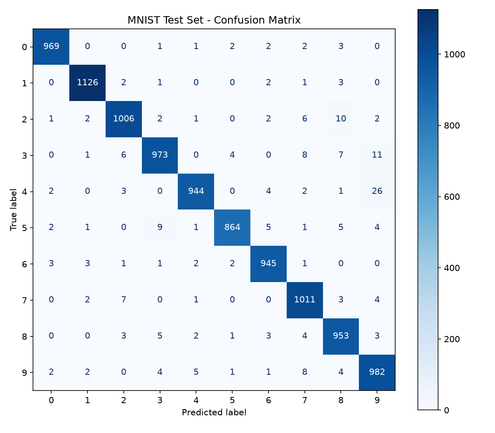
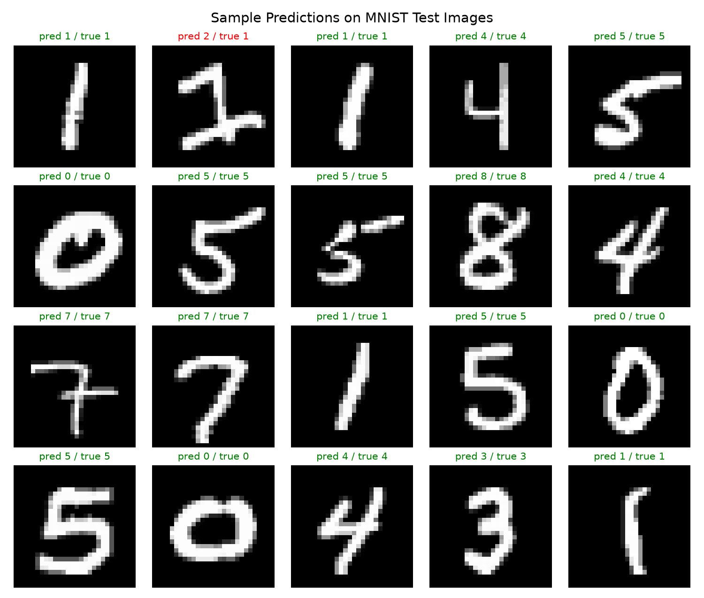
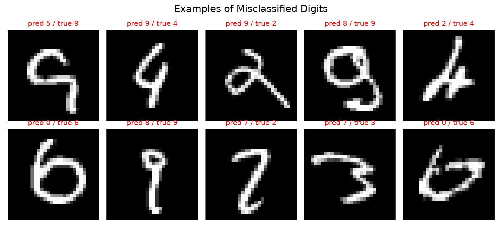

# Handwritten Digit Recognition using Machine Learning

**Internship Assignment Submission**  
**Submitted by:** Saket  
**Date:** 05 November 2026  
**GitHub repository:** https://github.com/luffy-code244/digit-recognition

## 1. Assignment Brief

### Assignment 1 – Machine Learning Internship Programme

| Field | Details |
|---|---|
| Assignment title | Handwritten Digit Recognition |
| Domain | Machine Learning / Computer Vision |
| Submission | Assignment report (PDF) + public GitHub repository link |
| Expected effort | 1 week |

**Objective.** Build a machine learning system that can recognise handwritten digits (0–9) from images. The intern should demonstrate the full ML workflow: loading a dataset, preprocessing, training a model, evaluating it with appropriate metrics, and using the trained model to make predictions on new images.

**Requirements.**

- Use the MNIST handwritten digit dataset (or an equivalent public dataset).
- Preprocess the data (normalisation, reshaping) appropriately for the chosen model.
- Train at least one classification model (e.g. Logistic Regression, SVM, MLP or CNN).
- Achieve a test accuracy of at least 95 % on held-out data.
- Evaluate the model with accuracy, a classification report and a confusion matrix.
- Provide a script or function that predicts the digit in a new image supplied by the user.
- Write clean, modular, documented code that someone else can run from the instructions.

**Deliverables.**

- Public GitHub repository containing source code, requirements file and a README with setup and run instructions.
- Saved trained model and result plots (confusion matrix, sample predictions).
- This assignment report in PDF format covering the problem, dataset, methodology, results, how to reproduce, and conclusion, with the GitHub link included.

**Evaluation criteria.** Correctness and accuracy of the model (30 %), code quality and structure (25 %), quality of the analysis and report (25 %), reproducibility and documentation (20 %).

## 2. Introduction and Problem Statement

Handwritten digit recognition is the task of automatically identifying which digit (0–9) is written in an image. It is a classic problem in computer vision and pattern recognition, with real-world uses such as reading postal codes on envelopes, processing bank cheques, digitising forms and grading exam sheets.

The difficulty comes from the large variation in human handwriting: the same digit can be written with different stroke thickness, slant, size and style, and some digits look alike (for example 4 and 9, or 3 and 5). A good recogniser must learn the general shape of each digit rather than memorising specific examples.

**Problem statement:** given a 28×28 grayscale image of a single handwritten digit, predict the correct digit class (one of 10 classes). This is a supervised multi-class classification problem. The goal of this project is to build, evaluate and package such a classifier so that it reaches at least 95 % accuracy on unseen test images and can be used on new images.

## 3. Dataset: MNIST

The project uses the **MNIST** (Modified National Institute of Standards and Technology) database, the standard benchmark for handwritten digit recognition. It is downloaded automatically from OpenML (*mnist_784*) using `sklearn.datasets.fetch_openml`.

| Property | Value |
|---|---|
| Total images | 70,000 |
| Training set | 60,000 images (standard split) |
| Test set | 10,000 images (standard split, never used in training) |
| Image size | 28 × 28 pixels, grayscale (784 features) |
| Pixel range | 0 (background) to 255 (ink) |
| Classes | 10 (digits 0–9), roughly balanced (~7,000 per class) |

Each digit was size-normalised to fit a 20×20 box and centred by centre of mass on a 28×28 canvas. The test set was written by different people from the training set, so test accuracy is a fair measure of how well the model generalises to new writers.

## 4. Methodology

### 4.1 Preprocessing

- **Flattening:** each 28×28 image is represented as a vector of 784 pixel values.
- **Normalisation:** pixel values are divided by 255 to lie in the range [0, 1]. This keeps the inputs on a similar scale and helps gradient-based training converge faster.
- **Data type:** features are stored as float32 to reduce memory usage.
- **Train/test split:** the standard 60,000 / 10,000 split is used. In addition, 10 % of the training set is held out internally as a validation set for early stopping.

### 4.2 Model choice

A **Multi-Layer Perceptron (MLP)**, a fully connected feed-forward neural network, was chosen using scikit-learn's `MLPClassifier`. Compared with linear models (e.g. Logistic Regression, ~92 % on MNIST) an MLP can learn non-linear combinations of pixels and reaches much higher accuracy, while still training in seconds on a CPU without needing a deep learning framework or GPU. An SVM with an RBF kernel can be similarly accurate but is far slower to train on 60,000 samples.

| Hyper-parameter | Value |
|---|---|
| Architecture | 784 → 256 (ReLU) → 128 (ReLU) → 10 (softmax) |
| Optimiser | Adam, learning rate 0.001 |
| Batch size | 128 |
| L2 regularisation (alpha) | 1e-4 |
| Max epochs | 30, with early stopping (patience 5 on validation accuracy) |
| Validation split | 10 % of training data |
| Random seed | 42 (reproducible) |

### 4.3 Training

The model was trained on 60,000 training images. Early stopping monitored the validation accuracy and stopped training after **14 epochs**, when it no longer improved, which prevents overfitting. Training took about **20 seconds** on an 8-core CPU. The trained model is saved with joblib to `models/digit_model.joblib`.



*Figure 1. Training loss and validation accuracy per epoch.*

### 4.4 Prediction on new images

To use the model on images that are not from MNIST (e.g. a photo or a digit drawn in Paint), `src/predict.py` applies the same preparation MNIST uses: convert to grayscale, invert if the background is light, crop to the digit, resize it into a 20×20 box keeping its aspect ratio, centre it on a 28×28 canvas by centre of mass, and scale to [0, 1]. It then prints the predicted digit, its confidence and the top-3 candidates.

## 5. Results

The final model was evaluated once on the 10,000 held-out test images.

| Metric | Value |
|---|---|
| Test accuracy | 97.73 % |
| Training accuracy | 99.40 % |
| Macro-averaged F1-score | 0.9772 |
| Misclassified test images | 227 of 10,000 |
| Epochs trained | 14 |
| Target from brief | ≥ 95 %  –  achieved |

The model achieves **97.73 % test accuracy**, comfortably above the 95 % target. Training accuracy (99.40 %) is only slightly higher than test accuracy, which shows the model generalises well and is not heavily overfitting.

### 5.1 Per-class performance

| Digit | Precision | Recall | F1-score | Test images |
|---|---|---|---|---|
| 0 | 0.9898 | 0.9888 | 0.9893 | 980 |
| 1 | 0.9903 | 0.9921 | 0.9912 | 1135 |
| 2 | 0.9786 | 0.9748 | 0.9767 | 1032 |
| 3 | 0.9769 | 0.9634 | 0.9701 | 1010 |
| 4 | 0.9864 | 0.9613 | 0.9737 | 982 |
| 5 | 0.9886 | 0.9686 | 0.9785 | 892 |
| 6 | 0.9803 | 0.9864 | 0.9834 | 958 |
| 7 | 0.9684 | 0.9835 | 0.9759 | 1028 |
| 8 | 0.9636 | 0.9784 | 0.9710 | 974 |
| 9 | 0.9516 | 0.9732 | 0.9623 | 1009 |

Every digit is recognised with an F1-score above 0.96. Digit **1** is the easiest (F1 0.9912) and digit **9** the hardest (F1 0.9623), mainly because other digits, especially 4, are sometimes predicted as 9.

### 5.2 Confusion matrix



*Figure 2. Confusion matrix on the MNIST test set (rows = true digit, columns = predicted digit).*

The confusion matrix has a strong diagonal: almost all images are assigned to their correct class. The largest off-diagonal values are: 4 predicted as 9 (26), 3 predicted as 9 (11), 2 predicted as 8 (10), 5 predicted as 3 (9). These errors make sense visually: a 4 with a closed top looks like a 9, the curves of 3 and 9 or 5 overlap, and a 2 with a loop at the bottom resembles an 8.

### 5.3 Sample predictions



*Figure 3. Random test images with predicted and true labels (green = correct, red = wrong).*



*Figure 4. Examples of misclassified test images.*

The misclassified examples are mostly unusually written, very slanted, broken or ambiguous digits that a human could also find hard to read. A custom black-on-white drawing of a 7 (`samples/handdrawn_7.png`) was also correctly predicted as 7 with high confidence, which confirms that the preprocessing pipeline works on non-MNIST images.

## 6. How to Run / Reproduce

The complete code is available at https://github.com/luffy-code244/digit-recognition. The trained model is included, so predictions work immediately; retraining is optional.

### Setup

```bash
git clone https://github.com/luffy-code244/digit-recognition.git
cd digit-recognition
python -m venv .venv
source .venv/bin/activate        # Windows: .venv\Scripts\activate
pip install -r requirements.txt
```

### Predict

```bash
python -m src.predict --image samples/digit_7.png   # your own image
python -m src.predict --demo -n 10                  # random MNIST test images
```

### Retrain (optional)

```bash
python -m src.train          # full training, writes models/ and outputs/
python -m src.train --quick  # fast smoke test on 10k images
```

### Repository structure

| Path | Purpose |
|---|---|
| src/common.py | Dataset download/caching and shared paths |
| src/train.py | Training, evaluation, saving the model, plots and metrics |
| src/predict.py | Image preprocessing and prediction (file or demo mode) |
| models/digit_model.joblib | Trained MLP model |
| outputs/ | Confusion matrix, sample predictions, training curve, metrics.json |
| samples/ | Example digit images for testing predict.py |
| requirements.txt | Python dependencies |
| README.md | Project overview, setup and usage |

## 7. Conclusion

This project built a complete handwritten digit recognition system using a Multi-Layer Perceptron trained on MNIST. With simple preprocessing (pixel normalisation) and a two-hidden-layer network, the model reached **97.73 % accuracy** on 10,000 unseen test images, exceeding the 95 % requirement, and trains in about 20 seconds on a CPU. The evaluation shows consistent performance across all ten digits, with the remaining errors concentrated on visually similar pairs such as 4/9 and 3/9.

All deliverables of the brief are met: a public GitHub repository with modular, documented code, a saved model, result plots, a prediction script for new images, and this report.

**Learning outcomes:** the end-to-end ML workflow (data loading, preprocessing, model selection, training with early stopping, evaluation with multiple metrics), interpreting a confusion matrix, and making a model usable on real-world inputs through consistent preprocessing.

**Future work:**

- Train a Convolutional Neural Network (CNN), which typically reaches 99 %+ on MNIST by exploiting the 2-D structure of images.
- Use data augmentation (rotation, shifting, scaling) to improve robustness to real handwriting.
- Build a simple web app or drawing canvas (e.g. Streamlit or Gradio) for live predictions.
- Extend to multi-digit recognition, such as reading full numbers.

## Appendix A. GitHub Repository

**https://github.com/luffy-code244/digit-recognition**

The repository contains all source code, the trained model (`models/digit_model.joblib`), the result figures in `outputs/`, the README with setup instructions, and this report.

### Appendix B. Software environment

| Component | Version / details |
|---|---|
| Language | Python 3 |
| Libraries | scikit-learn, NumPy, Matplotlib, Pillow, joblib, pandas |
| Hardware | 8-core CPU, no GPU required |
| Report generation | ReportLab (docs/build_report.py) |
